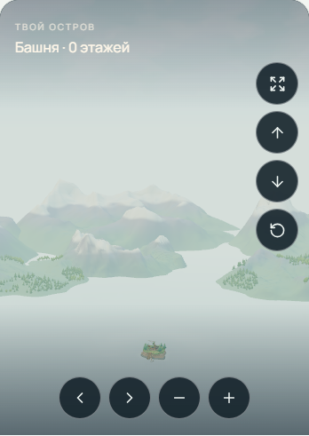
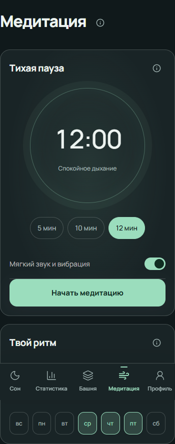

# Overman Sleep - «Превзойди себя»

Умный будильник и приложение для поддержки режима сна: дневник, наглядный прогресс, друзья и совместные договорённости.

Автор и разработчик: **Пётр Стеклянников / Petr Stekliannikov**.

## Идея

Мне хотелось сделать приложение, которое помогает не только проснуться, но и вовремя завершить день. Пользователь выбирает режим, ведёт дневник и видит прогресс в виде виртуальной башни. Друзья могут поддерживать друг друга и договариваться о совместном отходе ко сну.

## Возможности бета-версии

- Android-будильник, выбор звука и подтверждение пробуждения удержанием.
- Дневник сна, история, статистика и отдельная самооценка самочувствия.
- Трёхмерная башня: рост, повреждения и восстановление прогресса.
- Друзья с добровольными разрешениями на просмотр времени сна и прогресса.
- Приглашения «Пойдём спать» и совместные серии по синхронизированным записям.
- Медитация с таймером, мягким завершением и отдельной серией.
- Локальное хранение и резервные копии; синхронизация с собственным Go API и PostgreSQL.

## Интерфейс

Снимки интерфейса бета-версии на тестовых данных.

<p>
  
  
</p>

## Текущий статус

Снимок разработки от **15 ноября 2026 года**, Android-бета **0.4.45 / versionCode 48**. Основные локальные сценарии и серверные механики реализованы; продолжаются испытания на физических устройствах и подготовка публичного сервера. Фоновые push-уведомления для приглашений ещё не подключены. Совместные функции требуют запущенного сервера, а будильник и дневник доступны локально. Оценка сна экспериментальная.

[Скачать Android-бету](dist/overman-sleep-beta.apk?raw=true).

## Технологии и структура

| Часть | Технологии | Каталог |
| --- | --- | --- |
| Веб-клиент | React, Next.js, TypeScript, Three.js | `web/` |
| Android | Java, Android SDK, WebView, системный будильник | `android/` |
| API | Go, pgx, PostgreSQL | `server/` |
| Развёртывание | Docker Compose, Caddy, HTTPS | `deploy/vps/` |

## Локальный запуск веб-клиента

Установите Node.js и npm с поддержкой версии Next.js, указанной в `web/package-lock.json`.

```sh
git clone https://github.com/Optoed/Overman-Sleep.git
cd Overman-Sleep/web
npm ci
npm run dev
```

Откройте `http://127.0.0.1:3000`. Для сборки веб-версии: `npm run build`. Для работы друзей и синхронизации дополнительно нужен API и PostgreSQL.

## API и PostgreSQL

Потребуются Docker с Compose и Node.js для локальных сценариев подготовки. Из корня репозитория:

```sh
npm ci --ignore-scripts --prefix server
node server/scripts/local-db.mjs
node server/scripts/migrate.mjs
docker build -t overman-api:dev server
node server/scripts/local-api.mjs
```

Локальный API использует `http://127.0.0.1:3902`. Сценарии создают собственную локальную конфигурацию в игнорируемом каталоге `.tools/`. Детали размещения на сервере: [инструкция VPS](deploy/vps/README.md).

## Сборка Android на Windows

Потребуются PowerShell, JDK 17+, Android SDK Platform 35 и Build Tools 34.0.0. Сначала установите зависимости клиента через `npm ci` в `web/`, затем из корня проекта:

```powershell
./android/build-apk.ps1 -SdkRoot "C:/path/to/android-sdk" -JavaHome "C:/path/to/jdk"
```

Сценарий собирает веб-ресурсы и APK. Локальный ключ подписи создаётся отдельно; ключ разработчика в репозиторий не включён. Пересобранный APK с другим ключом устанавливается отдельно от ранее подписанной беты.

## Проверки

```sh
cd web
npm run typecheck
npm test
```

```sh
cd server
go test ./...
go vet ./...
```

Интеграционные проверки сервера требуют отдельной тестовой PostgreSQL. Браузерные интеграционные сценарии дополнительно используют Playwright, устанавливаемый в среду проверки. Исходники проверок размещены в `web/tests/`, `server/tests/` и `android/tests/`.

## Графические материалы

Источники и условия использования окружения: [CREDITS](web/public/world/CREDITS.txt). Лицензии шрифтов сохранены в `web/public/licenses/` и пакетах зависимостей.
